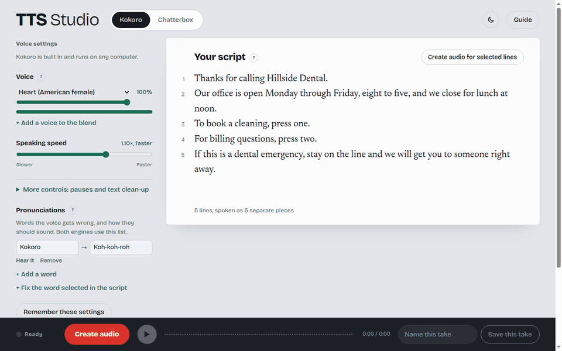
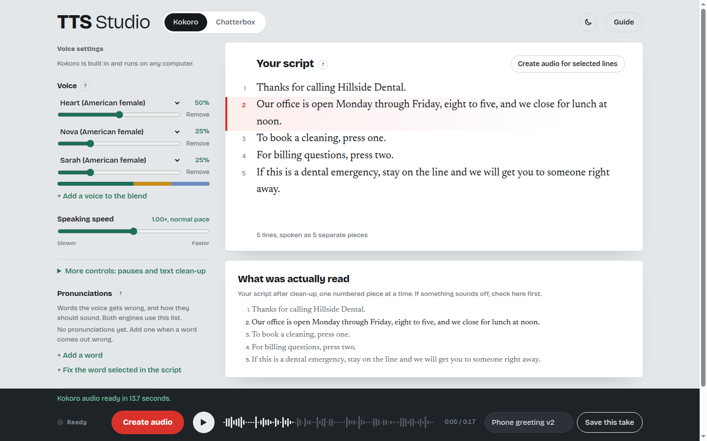
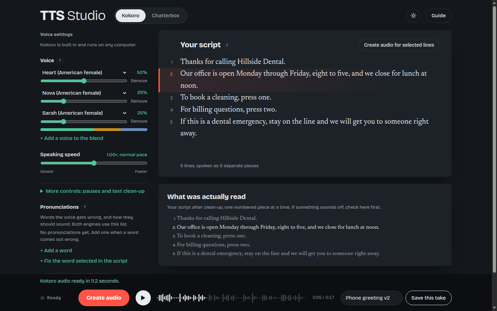
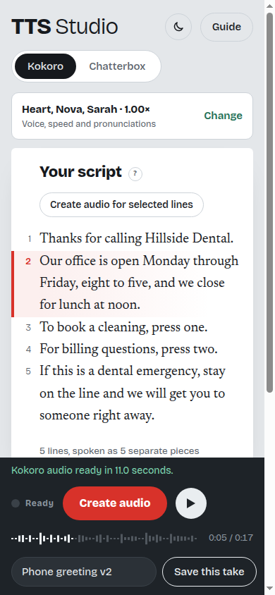

# TTS Studio

Turn a written script into natural-sounding narration, on your own computer. Paste a phone greeting, a training video script or a product walkthrough, pick a voice, and get a WAV file you can use. Nothing you type is sent anywhere.

**[Download TTS Studio](https://github.com/twogunrock/tts-studio/releases/latest/download/TTS-Studio.zip)** (Windows, Mac, Linux; free) · **[Hear a sample](https://github.com/twogunrock/tts-studio/releases/latest/download/sample-phone-greeting.mp3)**: an 18-second phone greeting, made with the built-in voice

It's built for people who need a voice-over and don't want to learn audio software: small businesses, trainers, anyone recording the same kind of message more than once.

Made by [Rocky Lott](https://rockylott.com).

## What it does

- **One line, one piece.** Every line of your script is spoken separately with a pause after it. Don't like one line? Reword it, select it and re-create just that line.
- **The line being spoken lights up** in your script as the audio plays, so you can hear a problem and see where it is.
- **Pronunciations.** Tell it once that "SQL" is said "sequel", and every script gets it right. Select a word in your script and press *Fix the word selected in the script*.
- **Blend voices.** Mix two or three of Kokoro's built-in voices into one of your own.
- **Takes you can recreate.** Saving a take keeps the audio, the exact settings, your script and the text that was actually spoken, side by side.
- **Light and dark.** It follows your computer's setting, and the sun/moon button switches it.

| Light | Dark | Phone |
|---|---|---|
|  |  |  |

## Two engines

**Kokoro** is built in. It's small (under 0.5 GB with its voice model), runs on any computer without a graphics card, and on an ordinary 6-core processor creates audio faster than it plays. Start here.

**Chatterbox** is an optional add-on for when you need more expression, or want to copy a voice from a 10-second recording. It costs more: about 9 GB of disk, and an NVIDIA graphics card to be practical (without one it runs about 20 times slower than real time). You install it yourself in its own Python environment, then show the studio where it is. The studio walks you through it.

## Install

1. **[Download TTS-Studio.zip](https://github.com/twogunrock/tts-studio/releases/latest/download/TTS-Studio.zip)** and unzip it somewhere you'll find it again (on Windows: right-click it, **Extract All**).
2. In the `TTS Studio` folder, double-click the start file for your computer:
   - **Windows:** `Start TTS Studio (Windows)`. Windows will ask whether to run a file downloaded from the internet; choose **Run**.
   - **Mac:** right-click `Start TTS Studio (macOS)` and choose **Open** (a plain double-click is blocked the first time for downloaded scripts).
   - **Linux:** run `Start TTS Studio (Linux).sh`.
3. The first time, it sets itself up: about 300 MB and a few minutes. Then the studio opens in your browser.
4. Press **Download the voice model** (about 350 MB, once). After that Kokoro works without the internet.

On Windows the first start also puts a **TTS Studio** shortcut on your desktop (on Linux, in your app menu); use it from then on. There's no window to keep open: the studio runs in the background while its browser tab is open, and stops by itself a few seconds after you close the tab. If something goes wrong, `studio.log` in the folder says what happened.

Everything, including its own copy of Python, is installed inside the folder. Nothing else on your computer changes, and deleting the folder removes TTS Studio completely.

**Comfortable with Python?** You can skip the start file: with Python 3.12, run `pip install -r requirements.txt`, then `python app.py`, and open http://127.0.0.1:7870. Add `--preview` to look around without a voice model (Create audio plays a short tone per line).

## Updates

Once a day, the studio asks GitHub for the newest version number. Nothing else is sent. When there's a newer version, a line above your script offers **What's new** and **Update**. Update replaces the program files, keeps everything that's yours (settings, pronunciations, saved takes, the voice model, voice recordings) and restarts the studio. The previous program files are kept in `tools/update/`. To turn the check off, untick **Check for updates once a day** at the bottom of Voice settings.

## Where things are kept

Everything stays in the studio's folder:

| What | Where |
|---|---|
| Saved takes | `exports/` |
| Voice model | `models/` |
| Pronunciations | `overrides.json` (edited in the studio) |
| Remembered settings | `preset.json` |
| Recordings for Chatterbox to copy | `voices/` |

## Using the audio

Kokoro (Apache 2.0) and Chatterbox (MIT) both allow commercial use. Chatterbox marks every clip with an inaudible watermark that identifies it as AI-generated. Only copy voices you have permission to use.

## Credits

- Built by [Rocky Lott](https://rockylott.com)
- [Kokoro-82M](https://huggingface.co/hexgrad/Kokoro-82M) by hexgrad, run through [kokoro-onnx](https://github.com/thewh1teagle/kokoro-onnx)
- [Chatterbox](https://github.com/resemble-ai/chatterbox) by Resemble AI
- Fonts: [Bricolage Grotesque](https://github.com/ateliertriay/bricolage) and [Newsreader](https://github.com/productiontype/Newsreader), SIL Open Font License

## License

MIT. See [LICENSE](LICENSE).
